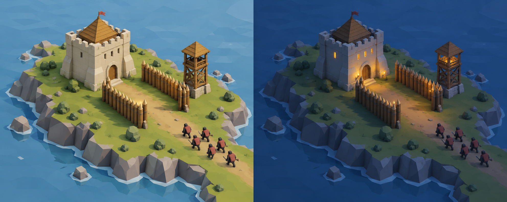
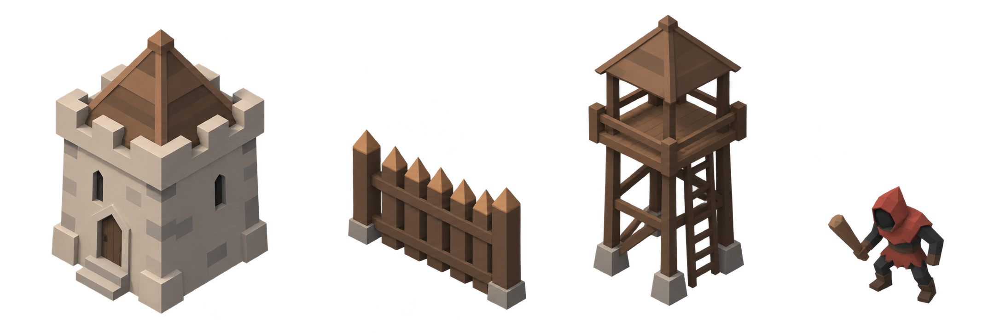

# The Last Fortress — visual direction

2026-10-15. First visual proposal, prepared for review and the prototype implementation agent. The gameplay specifications remain authoritative. New art must never change footprints, introduce extra buildings, or conceal enemy routing.

## Direction: a readable miniature fortress

A small timber-and-stone fortress on a grassy island, viewed like a tabletop miniature. Use broad shapes, visible polygon planes, matte surfaces, and restrained detail. Day feels calm and welcoming; night feels threatened but remains legible. The contrast between warm buildings and cool surroundings creates atmosphere without a large effects budget.

The player should recognize the Keep, choose where to build, and follow an enemy route before noticing decoration. Save the richest silhouette for the Keep; let the slender Tower and repeated palisade teeth explain defensive functions immediately.

This image establishes mood and materials. Its Keep size, island silhouette, corridor length, and relative building scale are illustrative. In Unity the prototype stays a flat, square 20 x 20 logical board with one-cell building footprints and a non-buildable boundary ring. Make the shoreline decorative outside that board; do not reproduce the image's irregular playable edge or oversized Keep footprint.

## Working palette

| Role | Color | Use |
|---|---|---|
| Grass | `#87935D` | Muted ground; keep it quieter than units |
| Dark grass | `#62724A` | Sparse ground variation, not checkerboard noise |
| Timber | `#996D43` | Walls, roof, Tower supports |
| Timber shadow | `#634830` | Facet variation and structural separation |
| Limestone | `#D8CCAE` | Keep, small foundations |
| Water/day | `#507E98` | Decorative shoreline outside the board |
| Night ambient | `#314B70` | Cool lighting reference, not a full-screen dark overlay |
| Enemy body | `#303538` | Grunt mass and limbs |
| Enemy cloth | `#AE5747` | Hostile identity; retain visible value contrast at night |
| Amber | `#E9B45F` | Torches, gold accents, main action |
| Route cyan | `#79C7C7` | Open-route overlay and selection |
| Warning coral | `#E67961` | Invalid placement and breach warnings |
| HUD surface | `#25323A` | Opaque-enough panels over grass/night |
| HUD text | `#F0E7D5` | Main labels and numerals |

These are working authoring colors, not exact samples from the generated images. Lighting changes their appearance; check final screenshots at normal play zoom. A dashed route/solid route, breach icon, invalid hatching, and text labels must communicate states without relying only on cyan/coral.

## Asset shape rules

| Asset | Primary silhouette | Unity blockout approach |
|---|---|---|
| Keep | Squat broad stone mass with compact pyramidal roof | Cube body, four large corner blocks, one roof mesh, dark door inset |
| Wall | Low repeated pointed stakes | One tile-wide cluster of 3-5 tapered posts and two rails |
| Archer Tower | Tall narrow open timber frame | Four posts, platform, simple roof, two cross braces |
| Grunt | Small hooded mass with readable weapon arm | Faceted capsule/body, hood wedge, short limbs, single blunt weapon |

Keep the prototype simple enough to model from primitives. One logical tile = one Unity unit. Base mesh extents must fit inside a 0.9 x 0.9 tile square; decorative roof overhang up to 0.05 units per side is acceptable if it does not imply another blocked tile. Ground origin/pivot is tile center. Suggested heights: Keep 1.6 units, Wall 0.8, Tower 2.0, Grunt 0.55. The generated lineup is an appearance reference; its object scale is not a measurement sheet.

Use flat shading and shared materials. Aim for roughly <=600 triangles per Keep/Tower, <=150 per Wall, <=250 per Grunt for the first modeled pass; these are authoring budgets to keep work small, not measured engine limits. No normal maps, texture painting, detailed masonry, facial features, loose cloth simulation, or individual arrow physics is needed. Roof timbers and stone blocks in the image may be simplified substantially.

Future MVP enemies should differ by silhouette: Runner lean and forward-tilted; Brute broad with a large club; Golem tall, heavy stone masses. Their exact art is deferred. Houses should read as compact roofs and Farms as low 2 x 2 crop plots; do not add either to the navigation prototype.

## Camera, light, and ground

- Start with orthographic camera yaw 45 degrees and downward pitch about 40 degrees; tune framing against the 20 x 20 board. Keep orientation fixed, retain pan/zoom/reset.
- Choose a default zoom where the full board fits and the Grunt still reads as a moving hostile silhouette. Test Tower occlusion: selected objects, route lines, and damaged Keep information must remain visible.
- Day: neutral/warm directional light, soft ambient fill, restrained shadows. Avoid glossy grass or deeply black structural gaps.
- Night: cooler ambient and weaker directional light, with a small number of amber focal lights at the Keep/Towers. Prefer emissive geometry and a shared light over one real-time shadow-casting light per building. Disable bloom initially; add only if readability improves.
- A damaging enemy must remain visible in the darkest playable area without torch coverage. Enemy readability is independent of simulated vision; the prototype/MVP have no fog of war.
- Render a subtle placement grid while a construction tool is active. Show the reserved outer ring distinctly in that mode. Keep the grid unobtrusive during combat.
- Ground decoration never blocks pathfinding. Avoid rocks, grass tufts, or decals in the prototype if they make a legal build cell look occupied.

## Interface direction

Use a restrained dark-slate HUD with ivory labels, small amber accents, and flat geometric icons. Aim for a practical strategy interface, with minimal ornament and no parchment scrolls or heavy medieval frames.

- Top-left: gold with gold icon and Keep health with heart icon; show numeric values as well as a health bar.
- Top-center: Day/Night state and remaining enemies; exact upcoming wave info visible during Day.
- Bottom-center: two build cards, Wall `20` and Archer Tower `70`, including hotkeys `1` and `2`. Keep is an inspected object, never a purchasable card.
- Bottom-right: primary Start Night action during Day, replaced by Pause/Resume during Night. Restart belongs in the menu and outcome overlay.
- Selection panel: building name, HP, and Sell during Day; hide the Sell action during Night. No Repair button in the one-wave prototype.
- Hover/selection: crisp cyan outline/range ring; ghost validity additionally uses a check/cross or pattern. Do not blur or darken the whole world while inspecting a route.
- Breach: mark the first attacked structure with a coral crosshair and explicit `BREACH` label. Open route is a continuous line; the hypothetical route beyond a blocker is dashed.
- Use the project's existing TMP/uGUI text path if established during implementation; font default should be an available legible sans-serif. No remote font dependency is required. Body labels should remain at least about 18 screen pixels at 1080p and readable in the 720p check.

The layout is a visual proposal, not a new gameplay requirement. Preserve specification 002's controls and UI behavior.

## Included simple graphics

- `concepts/day-night-direction.png` — generated day/night atmosphere reference.
- `concepts/prototype-asset-lineup.png` — generated transparent reference sheet; actual alpha preserved. Not a sprite atlas or a set of 3D models.
- `icons/keep.svg`, `icons/wall.svg`, `icons/archer-tower.svg`, `icons/grunt.svg`, `icons/gold.svg`, `icons/keep-health.svg` — original hand-authored 64 x 64 monochrome SVGs with transparent backgrounds, intended for toolbar/HUD use. See `icon-preview.html` on a dark background.
- `generation-prompts.md` — exact prompt set and built-in generation method.

SVGs are editable design sources, not automatically installed Unity UI assets. Use the project's existing supported import route; if no SVG importer exists, export PNGs at 64/128 px outside Unity or redraw equivalent simple shapes. Do not install a package just to display these six icons. White strokes are intended to be tinted by UI color. Costs and hotkeys belong in real text, not baked into icons.

## Implementation order and review gate

1. Implement the prototype with primitive meshes first, keeping this silhouette/color hierarchy.
2. Replace the four primitives with the simple models above once routing/combat are working. Do not use the generated scene as a texture or billboard world.
3. Apply this HUD direction without changing the specified interaction model.
4. Compare a daytime and nighttime gameplay screenshot at the default zoom and at 1280 x 720. Verify distinct building silhouettes, visible Grunts, clear open/breach routes, readable costs/HP, no apparent footprint ambiguity, and no critical object hidden behind the Tower.
5. Re-run the existing prototype performance fixture after the art pass. A visual reference alone does not validate performance or readability.

Treat this as the first coherent direction for owner review. It can evolve without changing the core mechanics. Gameplay implementation remains a separate task.
